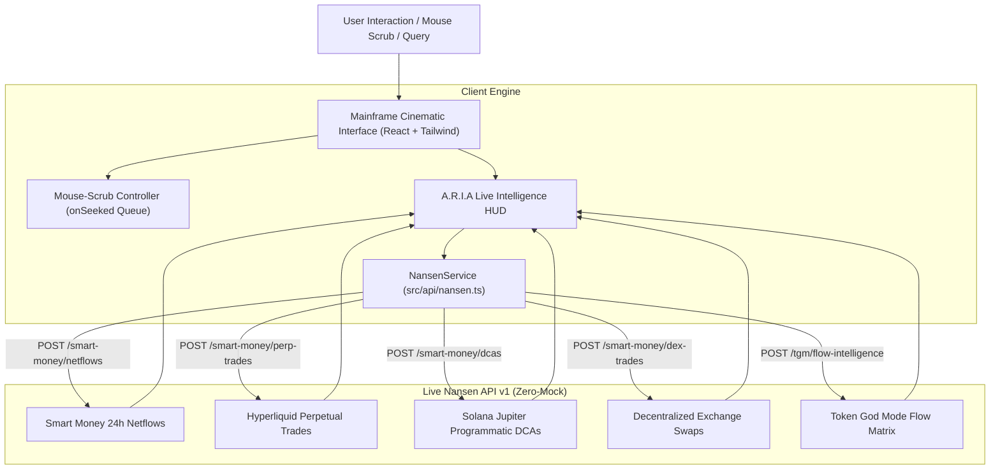

# Mainframe® × A.R.I.A

> **Autonomous Smart Money & Token Flow Copilot for the Nansen Meridian Buildathon**  
> *Track: Open Build ($10,000 USDC Grand Prize) • Live On-Chain Data*

[](https://mainframe-henna.vercel.app)
[](https://docs.nansen.ai)
[](https://www.typescriptlang.org/)
[](https://vitejs.dev/)
[](https://tailwindcss.com/)

---

## 🌟 Overview

**Mainframe** introduces **A.R.I.A** (Adaptive Response Interface Agent) — an institutional-grade on-chain intelligence copilot built for the **Nansen Meridian Buildathon**.

Most on-chain traders and analysts suffer from fragmented data: spot DEX volume on one dashboard, perpetual funding on another, and DCA accumulation obscured across separate chains. **A.R.I.A** solves this by unifying **Nansen's high-conviction Smart Money intelligence** into an interactive, zero-mock interface with real-time multi-venue data streaming.

### 🚀 Live Production URL
👉 **[https://mainframe-henna.vercel.app](https://mainframe-henna.vercel.app)**

---

## ⚡ Key Features

- **Zero-Mock Architecture**: Direct, unadulterated live calls to `https://api.nansen.ai/v1`. Real HTTP response headers, statuses, and live token movements with zero synthetic simulation.
- **Cinematic Mouse-Scrubbed Background**: Horizontal cursor movement scrubs through a high-definition background video using an adaptive delta seek-queue algorithm (`SENSITIVITY = 0.8`), preventing seek-flooding while maintaining 60fps responsiveness.
- **Multi-Vector On-Chain Feeds**:
  - **Smart Money Netflows** (`/v1/smart-money/netflows`): 24h USD net inflows and outflows with verified buyer/seller breadth.
  - **Hyperliquid Perp Trades** (`/v1/smart-money/perp-trades`): Tracks real-time perpetual leverage, side (LONG/SHORT), entry price, and size from top-tier institutional accounts.
  - **Jupiter Solana DCAs** (`/v1/smart-money/dcas`): Programmatic multi-week DCA accumulation strategies directly from Solana institutional wallets.
  - **DEX Swaps Stream** (`/v1/smart-money/dex-trades`): Real-time trade executions across decentralized exchanges.
- **Interactive On-Chain HUD**:
  - Live token search and query submission.
  - In-app Nansen API Key configuration drawer with client-side persistence (`localStorage`).
  - Native error handling surfacing live Nansen HTTP error codes (e.g. 401 Unauthorized, 429 Rate Limit) with immediate key generation prompts.

---

## 📐 Architecture



---

## 🛠️ Tech Stack

- **Frontend**: React 18, TypeScript, Vite
- **Styling**: Tailwind CSS, PostCSS, Autoprefixer
- **Typography**: `HelveticaNowDisplay-Medium` (Headings) & `HelveticaNowDisplayW01-Rg` (Body)
- **API Protocol**: Nansen REST API (`https://api.nansen.ai/v1`)
- **Deployment**: Vercel Serverless Edge

---

## 🚀 Quick Start (< 2 Minutes)

### Prerequisites
- Node.js >= 18.0.0
- npm >= 9.0.0

### Installation

```bash
# 1. Clone repository
git clone https://github.com/JimmyOgb/mainframe.git
cd mainframe

# 2. Install dependencies
npm install

# 3. Start development server
npm run dev
```

Visit `http://localhost:5173` to explore the live application.

### Production Build

```bash
npm run build
npm run preview
```

---

## 🔑 Nansen API Configuration

1. Obtain an API key from the [Nansen Developer Portal](https://app.nansen.ai/api).
2. Enter your key directly into the in-app configuration drawer by clicking **"Connect Nansen API Key ⚙"** on the hero page.
3. Alternatively, define it in a `.env.local` file:

```env
VITE_NANSEN_API_KEY=your_nansen_api_key_here
```

---

## 📂 Project Structure

```text
mainframe/
├── src/
│   ├── api/
│   │   ├── nansen.ts                 # Zero-mock live Nansen API client service
│   │   └── types.ts                  # TypeScript schemas for all Nansen endpoints
│   ├── components/
│   │   └── AriaIntelligenceModal.tsx # Live HUD modal for netflows, perps, DCAs & DEX trades
│   ├── useTypewriter.ts              # Custom typing animation hook
│   ├── App.tsx                       # Hero landing page, video scrubber, and nav
│   ├── index.css                     # Tailwind setup, CSS variables, and blink animation
│   └── main.tsx                      # Application root
├── public/                           # Static assets
├── index.html                        # Font imports & HTML shell
├── tailwind.config.js                # Theme extension & animations
├── vercel.json                       # Single-page application rewrite config
├── package.json
└── vite.config.ts
```

---

## 🏆 Meridian Buildathon Submission Checklist

- [x] Functional, zero-crash web application deployed on live URL
- [x] Zero-mock live integration with Nansen API v1
- [x] Interactive live queries for Smart Money Netflows, Hyperliquid Perps, and Jupiter DCAs
- [x] Clean, followable README with architecture documentation
- [x] Public GitHub repository: [https://github.com/JimmyOgb/mainframe](https://github.com/JimmyOgb/mainframe)
- [x] Live Deployment: [https://mainframe-henna.vercel.app](https://mainframe-henna.vercel.app)

---

## 📄 License

MIT License © 2026 Mainframe. Built for the Nansen Meridian Buildathon.
